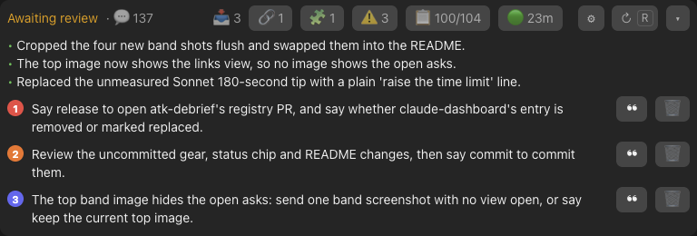
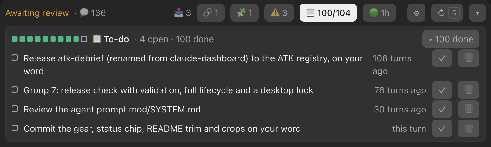
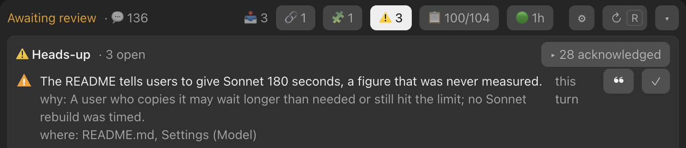
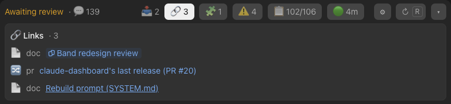
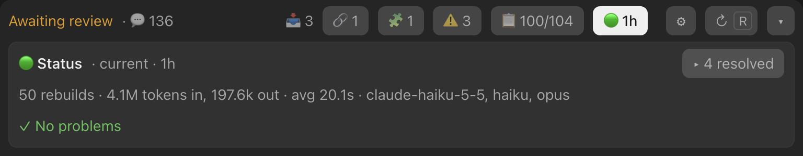
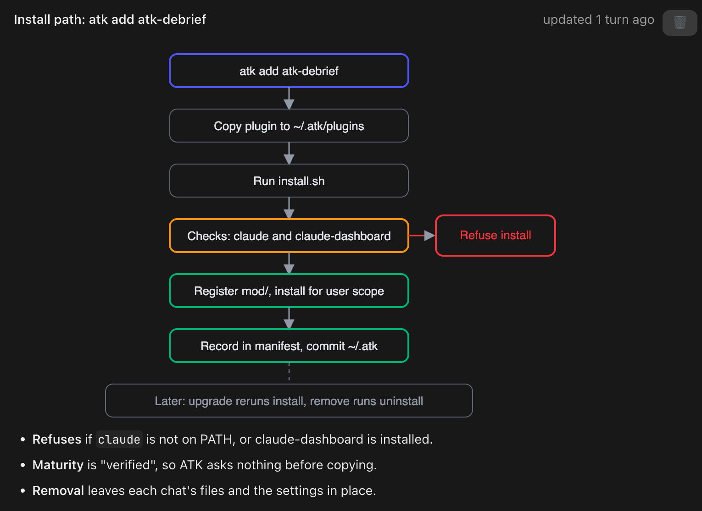
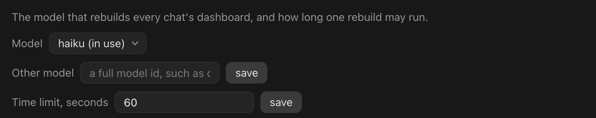

# ATK Debrief

**Read the dashboard, not the transcript.**

A live dashboard for every Claude Code chat, in a band above the prompt: what the agent needs from you, how far
along the work is, and what you would otherwise miss, in structured form and a click away. You do nothing to make it
happen. After each turn, a small model call (Haiku by default, on your own account) rebuilds it from the chat.

**Beta (0.1.2).** Expect rough edges, and please [report a problem](#report-a-problem) when you find one.

```bash
claude plugin marketplace add Svtoo/atk-registry
claude plugin install atk-debrief@atk-registry
```

Run these in a terminal; they need the `claude` command ([Claude Code setup](https://code.claude.com/docs/en/setup)).
New chats show the band; a chat already open shows it after `/reload-plugins`. Made for the Claude desktop app (Code
tab); for the terminal, see [Known limits](#known-limits).



## Why

- A coding agent's transcript is long, linear and full of tool output. The question it asked you scrolls away.
- The plan, the risks it took on quietly, and the PRs, issues and docs it named are scattered over hundreds of
  messages.
- ATK Debrief pulls them into one structured dashboard per chat, each a click away. It builds itself when each turn
  ends: nothing to run, tag or update.

## What you get

- **Call to action**: each open ask, numbered and coloured by how long it has waited. ❝ quotes it into the prompt
  box, after what you typed; 🗑 dismisses it. When it reads ✓ Nothing pending, nothing waits on you.
- **Last turn**: what the agent did, in a few bullets.
- **Phase**: Planning, Building, Blocked, Awaiting review or Shipped, with the turn count.
- **📋 To-do**: the plan's progress bar and its steps. ✓ checks one off, 🗑 drops it.
- **⚠️ Heads-up**: silent changes and risks the chat buried, most severe first, each with where to look. ✓
  acknowledges one and it folds away.
- **🔗 Links**: the issue, the PR, the branch or the design doc you keep going back to. 🗑 dismisses one and it
  folds away.
- **🧩 Freeform cards**: designs, diagrams and key terms in a pane beside the chat, as Markdown and SVG drawn in your
  theme's colours. The pane opens by itself when a chat has live cards, and again when one is new or changes.
- **Status**: a dot and the dashboard's age: 🟢 current, 🔵 updating, 🟡 behind or 🔴 a problem. Its view holds the
  chat's rebuild totals and the steps that fix a problem.

Each ✓ and 🗑 saves straight into the chat's dashboard, with ↶ to undo it until the next rebuild takes it in. An
acknowledged heads-up keeps its ↶.

## See it

**To-do**: the plan's progress and the steps left, each with ✓ and 🗑.



**Heads-up**: what changed or could bite you, why it matters, and where to look.



**Links**: the PRs, issues and docs the chat names, collected as it goes, one click away.



**Status**: whether the dashboard is current, the chat's rebuild totals, and any problem with its fix.



**Freeform cards**: reference material the model draws in a pane beside the chat, diagrams included.



## Install with ATK

If you use [ATK](https://github.com/Svtoo/atk), install it with ATK instead of the commands at the top. Use one way
only: each install draws its own band.

```bash
atk add atk-debrief
```

`atk status atk-debrief` says whether it is installed; it needs `python3`.

## Settings

⚙ on the band, or `/debrief-settings`, opens them. They apply to every chat.

- **Model**: the model that rebuilds the dashboard. `haiku` (Haiku 5.5) by default: fast, cheap, and good enough for a
  dashboard. If the dashboards miss things, pick `sonnet`: better results, at a higher cost and a longer wait each turn.
  If its rebuilds run out of time, raise the time limit.
- **Other model**: a specific model id, such as `claude-haiku-5-5`, used instead of the Model pick. Picking a Model
  clears it.
- **Time limit**: how long one rebuild may run, 60 seconds by default.



## Pause it

- Everywhere: `claude plugin disable atk-debrief`, and `claude plugin enable atk-debrief` to bring it back.
- In one project, for you alone: run the same command in that project's folder with `--scope local`.

## Cost

- One rebuild per turn the agent finishes, plus one per ↻ press. A turn that a task notice or `/loop` starts counts
  too, so a `/loop` every few minutes rebuilds as often. A rebuild calls the model through your own Claude Code
  sign-in: on a subscription it counts against your usage limits; on API billing it is charged.
- A typical rebuild on Haiku: about 50,000 tokens in and 4,000 out, in about 20 seconds.
- A rebuild makes at most three calls: one more after a busy or rate-limited reply, and one more to correct an
  answer the dashboard cannot use. Picking a new model in the settings makes one short check call.
- The status view shows the chat's totals for the rebuilds that saved: how many, tokens in and out, average time and
  models. Failed calls are not counted, and no price is shown.
- A session that never draws the band, such as `claude -p`, records nothing and calls no model.

## Privacy and files

- Its only outside call is the model call, made through Claude Code to the model you set.
- A rebuild sends the model the dashboard, the newest turn with its tool calls and output, and the two turns before
  it as text: at most about 100,000 words of the chat, with the middle of longer output cut.
- Each chat's dashboard is `state.json` in Claude Code's folder for that chat, under `~/.claude/projects/` (or
  `$CLAUDE_CONFIG_DIR/projects/`). Beside it, `tail-0.json` to `tail-2.json` hold the chat's last three turns, tool
  input and output included.
- To delete a chat's dashboard, delete those files, and `state.json.damaged` if there is one. Leave the rest of the
  folder: it is Claude Code's.
- The settings live in Claude Code's plugin store.
- Your transcript is never changed: the plugin only reads the session's messages.

## How it builds the dashboard

- Each message you send opens a turn, one typed while the agent works included. A task notice or a peer session
  opens none; what it adds goes into the turn it lands in.
- When a turn ends, the mod records it and rebuilds the dashboard in the background. The model's prompt is
  [`mod/SYSTEM.md`](mod/SYSTEM.md); it answers with schema-checked edits that the mod folds into the dashboard.
- Items stay put. A done to-do and an acknowledged heads-up are locked: the model cannot change them. Open items are
  left alone unless they are clearly wrong or useless, or you ask for a change. Your own ✓ and 🗑 always work.
- A turn you stop is recorded but not rebuilt: the status shows 🟡 behind until your next turn, or ↻.
- A rebuild that fails leaves the dashboard as it was and shows as a problem in the status view until a rebuild
  succeeds.
- A press made while a rebuild runs stays as you left it when the rebuild saves.
- A forked chat starts from the dashboard of the chat it left, as it stood at the fork.

## Update

```bash
claude plugin marketplace update atk-registry
claude plugin update atk-debrief@atk-registry
```

With ATK: `atk upgrade atk-debrief`.

New chats run the new version; a chat already open runs it after `/reload-plugins`.

## Uninstall

```bash
claude plugin uninstall atk-debrief@atk-registry
claude plugin marketplace remove atk-registry
```

With ATK: `atk remove atk-debrief`.

This removes the mod. Each chat's `state.json` and tail files stay in place, as do the settings.

## Coming from claude-dashboard

- ATK Debrief replaces claude-dashboard. Remove it first with `atk remove claude-dashboard`, then install.
- Each chat keeps its dashboard, as both read the same `state.json`. A card in the old HTML format shows a note until
  the next rebuild rewrites it.

## Known limits

- The terminal is not officially supported. A terminal session of Claude Code 2.1.308 or later runs the mod, but
  parts of it may not work there.
- In a chat that already had history when the plugin was installed, the dashboard starts from the next turn:
  earlier turns are not read.
- The ATK install scripts are bash: macOS and Linux.
- Claude Code reads and writes files of at most 4 MiB. A very long chat whose dashboard grows past that stops saving,
  and each press and turn says so.
- A `state.json` that no longer parses is kept beside it as `state.json.damaged`, and the dashboard starts afresh.

## Report a problem

[Open an issue](https://github.com/Svtoo/atk-registry/issues) with the text under ▸ on the problem in the status view.
